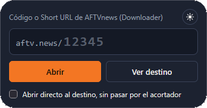

# AFTV Short URL para Firefox

[](https://github.com/willljp93/aftv-short-url-firefox/actions/workflows/ci.yml)
[](https://github.com/willljp93/aftv-short-url-firefox/releases/latest)
[](LICENSE)

Extensión de Firefox para abrir en un clic los **códigos y Short URLs de [go.aftvnews.com](https://go.aftvnews.com)** (por ejemplo `12345` o `aftv.news/12345`), los mismos que se escriben en la app **Downloader** de Amazon Fire TV y Android TV.

> Proyecto no oficial: no está afiliado a AFTVnews ni al autor de Downloader. «AFTVnews» y «Downloader» pertenecen a sus respectivos dueños.

<p align="center">
  
</p>

## Características

- Cuadro pequeño: escribe el código (o pega `aftv.news/12345`) y pulsa **Enter**.
- **Ver destino**: muestra la URL final real sin abrirla, para que decidas si te fías. Las URLs acortadas son públicas.
- **Abrir directo al destino** (opción): salta la página intermedia con cuenta atrás del acortador.
- Recuerda el último código y tiene un botón **X** para borrarlo.
- Modo claro / oscuro con un botón (por defecto sigue el tema del sistema).
- Barra de direcciones: escribe `aftv 12345` y pulsa Enter.
- Atajo de teclado: `Alt+Shift+A` abre el popup.
- Sin cuentas, sin rastreo y sin servidores propios (ver [Privacidad](#privacidad)).

## Instalación

### Desde GitHub Releases

1. Descarga el archivo de la [última versión](../../releases/latest):
   - **`.xpi` firmado** (si la release lo incluye): ábrelo con Firefox o arrástralo a una ventana. Instalación permanente.
   - **`.zip`**: instalación temporal (dura hasta cerrar Firefox):
     1. Abre `about:debugging#/runtime/this-firefox`.
     2. Pulsa **Cargar complemento temporal…** y elige el `.zip`.
2. Para una instalación permanente sin firma necesitas Firefox Developer Edition, Nightly o ESR con `xpinstall.signatures.required = false` en `about:config`. Para que cualquiera la instale de forma permanente hay que firmarla: ver [docs/PUBLICAR.md](docs/PUBLICAR.md).

### Desde el código fuente

```bash
git clone https://github.com/willljp93/aftv-short-url-firefox.git
cd aftv-short-url-firefox
npm ci
npm start        # abre Firefox con la extensión cargada
```

## Uso

| Acción | Cómo |
| --- | --- |
| Abrir un código | Escribe `12345` (o pega `aftv.news/12345`) y pulsa **Abrir** o **Enter** |
| Ver a dónde lleva | Pulsa **Ver destino** |
| Saltarte el acortador | Marca «Abrir directo al destino, sin pasar por el acortador» |
| Borrar el campo | Pulsa la **X** circular |
| Cambiar de tema | Pulsa el botón luna / sol de la esquina |
| Desde la barra de direcciones | `aftv 12345` + Enter |
| Abrir el popup con el teclado | `Alt+Shift+A` |

Los códigos del acortador son solo números. Si pegas una URL completa de `aftv.news` o `go.aftvnews.com`, se queda solo el código.

## Desarrollo

Requisitos: [Node.js](https://nodejs.org/) 20 o superior y Firefox.

| Comando | Qué hace |
| --- | --- |
| `npm ci` | Instala las dependencias (`web-ext` y `jsdom`) |
| `npm start` | Abre Firefox con la extensión cargada y recarga al guardar |
| `npm run lint` | Valida el manifiesto y el código con `web-ext lint` |
| `npm test` | Ejecuta las pruebas (`node:test` + `jsdom`) |
| `npm run build` | Genera `dist/aftv-short-url-<versión>.zip` |
| `npm run sign` | Firma la extensión en AMO (canal no listado); requiere claves, ver [docs/PUBLICAR.md](docs/PUBLICAR.md) |

### Estructura

```text
src/                     extensión (lo que se empaqueta)
  manifest.json          manifiesto MV2 (permisos, atajo, palabra clave aftv)
  popup.html/.css/.js    interfaz del popup
  theme.js               aplica el tema antes de pintar (evita parpadeos)
  shared.js              BASE y parseCode()
  extract.js             extractDestination() y resolveDestination()
  background.js          barra de direcciones (omnibox)
  icon.svg               icono
tests/                   pruebas y fixture de la página real del acortador
docs/                    documentación técnica
.github/workflows/       CI y publicación automática en Releases
```

## Publicar una versión

Primera vez desde Windows: [docs/SUBIR_A_GITHUB_WINDOWS.md](docs/SUBIR_A_GITHUB_WINDOWS.md). Firmar e instalar en Firefox: [docs/PUBLICAR.md](docs/PUBLICAR.md).

1. Actualiza la versión en `src/manifest.json` **y** en `package.json`, y anótala en `CHANGELOG.md`.
2. Haz commit y crea la etiqueta:

   ```bash
   git commit -am "Versión 1.3.0"
   git tag v1.3.0
   git push origin main --tags
   ```

3. GitHub Actions (`.github/workflows/release.yml`) comprueba que la etiqueta coincide con las versiones, ejecuta lint y pruebas, genera el zip y lo adjunta a una nueva release con notas automáticas. Si configuraste las claves de AMO, también adjunta el `.xpi` firmado.

El workflow ya declara `contents: write`, así que normalmente no hace falta cambiar los permisos del repositorio. Si la release falla con un error 403, revisa **Settings → Actions → General → Workflow permissions**.

## Privacidad

- No recoge ni envía datos personales ni usa analítica.
- Solo hace peticiones a `aftv.news` y `go.aftvnews.com` cuando tú pulsas **Ver destino**, **Abrir** con la opción directa activada o usas la barra de direcciones con esa opción.
- Guarda localmente en tu navegador: el último código, la opción de abrir directo y el tema.

### Permisos

| Permiso | Para qué |
| --- | --- |
| `storage` | Recordar el último código y la opción de abrir directo |
| `*://aftv.news/*` | Resolver el código y abrir el acortador |
| `*://go.aftvnews.com/*` | Leer la página intermedia para mostrar el destino final |

## Cómo funciona

Resumen en [docs/ARQUITECTURA.md](docs/ARQUITECTURA.md). Si AFTVnews cambia el HTML de su página intermedia, solo hay que ajustar `extractDestination()` en `src/extract.js`; las pruebas con la página real (`tests/fixtures/go-redirect.html`) te avisarán.

## Licencia

[MIT](LICENSE).
