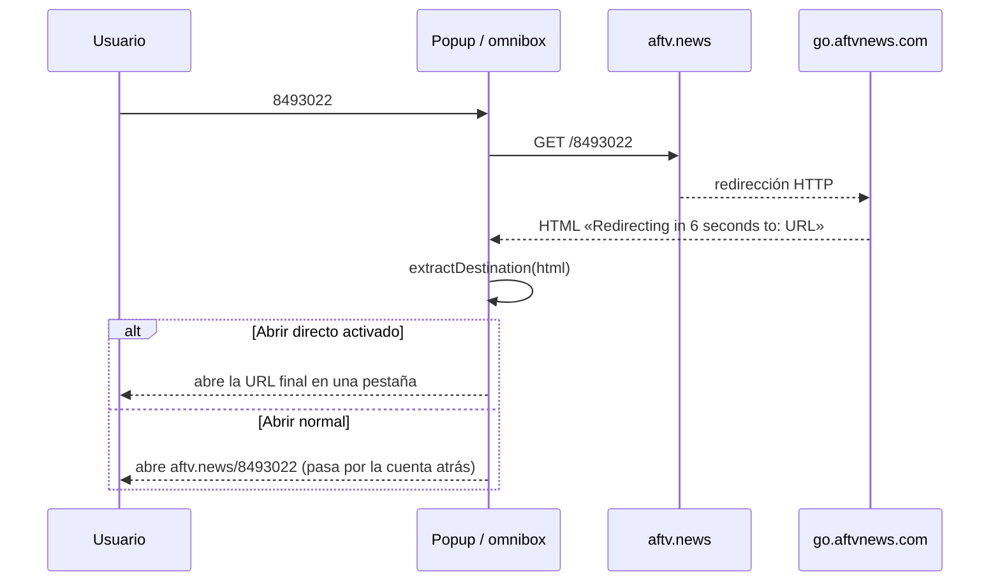

# Arquitectura

## Flujo de un código

La página intermedia de `go.aftvnews.com/<código>` redirige con **JavaScript** (`window.location = "…"`) tras una cuenta atrás. Por eso no basta con leer cabeceras HTTP: hay que leer el HTML.

## Módulos (`src/`)

| Archivo | Responsabilidad |
| --- | --- |
| `shared.js` | `BASE` (`https://aftv.news/`) y `parseCode()`, que acepta `12345`, `aftv.news/12345`, `https://aftv.news/12345/` y `go.aftvnews.com/12345` |
| `extract.js` | `extractDestination(html)` y `resolveDestination(código)` |
| `popup.*` | Interfaz, persistencia (`browser.storage.local`) y acciones Abrir / Ver destino |
| `theme.js` | Fija `data-theme` antes de pintar, leyendo `localStorage` o el tema del sistema |
| `background.js` | Palabra clave `aftv` de la barra de direcciones; respeta la opción de abrir directo |

Los scripts son clásicos (no módulos) y comparten ámbito global. El orden de carga está en `popup.html` y en `background.scripts` del manifiesto.

## Extracción del destino

`extractDestination()` analiza el HTML con `DOMParser` (no ejecuta scripts ni carga recursos) y prueba, en orden:

1. `<meta http-equiv="refresh" content="…; url=…">`.
2. Un enlace cuyo **texto visible** es una URL (el enlace naranja de la página actual).
3. Atributos `data-url`, `data-href`, `data-redirect` o `data-target`.
4. JavaScript en línea con `location = "…"`.
5. La primera URL externa del texto visible (sin scripts ni estilos).

Solo se aceptan URLs `http(s)` que **no** sean de `aftvnews.com` ni `aftv.news`. Si no hay ninguna, devuelve `null` y la interfaz lo dice en lugar de adivinar.

## Seguridad

- El destino se muestra con `textContent`, nunca con `innerHTML`.
- Solo se abren destinos `http(s)`; `javascript:`, `data:` y similares se descartan.
- Se hace `fetch` con `credentials: "omit"` y `cache: "no-store"`.
- Los códigos son numéricos y los destinos son públicos: la opción de abrir directo se salta la pantalla donde se puede revisar la URL, por eso viene desactivada por defecto.

## Almacenamiento

- `browser.storage.local`: `code` (último código) y `direct` (abrir directo).
- `localStorage` del popup: `theme` (`light` o `dark`), para poder aplicarlo de forma síncrona antes de pintar.

## Pruebas

- `tests/extract.test.js`: `parseCode`, todas las estrategias de extracción y `resolveDestination` con `fetch` simulado.
- `tests/popup.test.js`: carga `src/popup.html` en jsdom con `browser.*` simulado y comprueba persistencia, X, tema, Abrir (directo y normal) y Ver destino.
- `tests/fixtures/go-redirect.html`: copia recortada de la página real del acortador. Si cambia su HTML, actualiza este archivo y `extractDestination()`.
